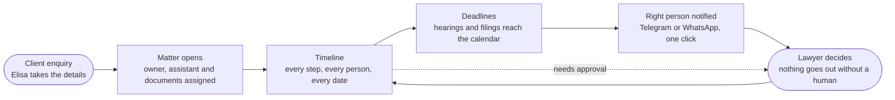

> Copy rules used: short headings, calm confident verbs, no technology names, no numbers we cannot prove (the site already marks its figures as illustrative — keep that). The technical version lives in [[LexFlow-Wave1-Build-Log-Technical-2026-10-25]].

# One place where every matter moves forward

## Hero line
**Your firm, in one clear picture.**
From the first enquiry to the final hearing, LexFlow shows who is doing what, what is due, and what needs a lawyer — before anyone has to ask.

## The picture (diagram for the page)

**How to draw it on the site:** a single horizontal line of six rounded nodes in the brand navy/gold, the dotted "needs approval" loop in gold, nodes lighting up left-to-right on scroll. No icons of servers, databases or code.

## Four reasons it feels different

**◈ A timeline that tells the story**
See every matter as a clear timeline. Each step shows the people responsible — case owner, document supplier, legal assistant — each in their own colour, so the whole office understands the situation in a second.

**◎ The right documents, at the right stage**
Open the folder a step needs straight from the timeline. The documents are already where the team expects them, ready for whoever picks up the next task.

**◇ A lawyer stays in charge**
Anyone — or anything — on the team can raise a hand with one click: "this needs the lawyer." It goes to the right person, with the reason, and waits for their decision.

**◉ Deadlines you can't miss**
Hearings, filings and mandatory time limits appear in the calendar next to everything else. Overdue work is visible at a glance, not discovered on the day.

## A day with LexFlow
- **Morning** — you open the timeline and see what is due today and what is waiting for you.
- **Midday** — your assistant uploads the documents; the next step lights up for the owner.
- **Afternoon** — one tap sends a short, discreet message to the colleague who needs to act.
- **Evening** — nothing is lost in an inbox; tomorrow is already planned.

## Built for trust
Your clients' details stay private: team messages never include client names, and notifications are sent only to colleagues who have agreed to receive them. Handled under EU GDPR requirements.

## Call to action
**See your firm's matters the way they should look.**
[ Start your 14-day free trial ] · [ Book a 20-minute walkthrough ]
*No credit card required.*

---
### Notes for the web team (not for publication)
- Do not publish figures for this section until pilot data exists; if a stat strip is wanted, reuse the site's "illustrative" labelling.
- Do not name WhatsApp/Telegram as "integrated services" until real sending is live — the current build offers link-based sharing; say "one-click message" on the page.
- Do not mention AI agents on this page until the in-app assistant ships; the "anyone — or anything" line is deliberately neutral.
- Asset suggestions: reuse Romanelli studio photography and the gold/navy palette already on the site; diagram as inline SVG, 1200×420, light and dark variants.

## Links
- Parent: [[LexFlow-Platform-Plan-2026-10-24]]
- Related: [[LexFlow-Wave1-Build-Log-Technical-2026-10-25]], [[LexFlow-Product-Research-KeyFeature-Lexroom-Agent-2026-10-24]]
