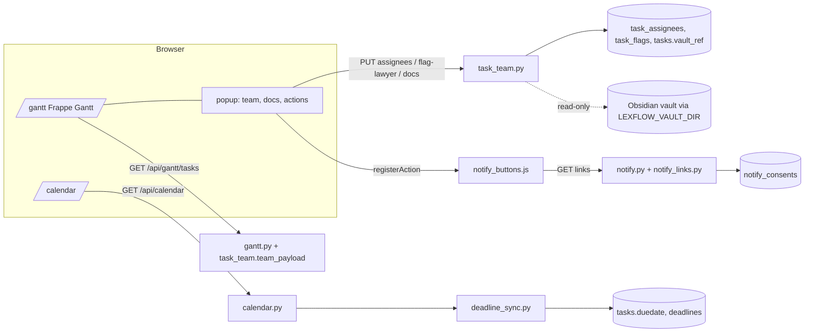

# 1. What was asked
Ole, 2026-10-24: (1) Gantt weekly view — diagram and month header not visually glued; (2) show the responsible team members per task inside the timeline, fetched from the Team, one colour per role, agent-usable (docs link into the vault, "flag the lawyer"); (3) deadlines on some tasks and prove they reach the Calendar; (4) Telegram and WhatsApp buttons; (5) Harvey-style usage diagrams, a key feature, Lexroom integration, an in-app AI agent, GitHub survey. Rules: isolated branches, cross-test by another agent, Admy tests last, only then merge locally; nothing pushed.

# 2. Architecture of what was added (all flag-gated, default OFF)

Tenant scoping everywhere through `workspace_filter` / `get_visible_workspace_ids`; superadmin sees all, firm admin sees firm + client sub-workspaces, a client sub-workspace admin and a foreign tenant admin see only their own.

## A — Gantt (owner: backend-dev) — branch feat/gantt-team-roles
- **Glue fix.** Frappe puts the header in a sticky `.grid-header`, but the container was as tall as the grid (`container_height:'auto'`), so the *page* scrolled and the sticky header scrolled away with it. Fix: fixed-height scroller `chartHeight(rows)=min(content, innerHeight-300)` (gantt_view.js).
- **Data model.** `task_assignees(task_id, team_member_id → firm_team_members, role, workspace_id)` with unique (task, member, role); `task_flags(task_id, raised_by_user_id, raised_by_agent, target_member_id, reason, status)`; `tasks.vault_ref` (vault-relative folder). Roles + colours live in ONE map `TASK_ROLES` (models/task_assignee.py) mirrored by `.role-<key>` CSS: case_owner amber, docs_supply cyan, legal_assistant violet, lawyer_review rose. Migration `h9c0d1e2f3a4` + `_ensure_schema` ALTER for `vault_ref`.
- **People come from the Team** (`FirmTeamMember`, already tenant-scoped); assigning a member from another workspace is rejected (a client sub-workspace may use its parent firm's team).
- **API** (crm/routes/task_team.py): `PUT /api/gantt/tasks/<id>/assignees` (admin), `PUT …/vault-ref` (superadmin), `GET …/docs` (superadmin — lists files under the task's `vault_ref` for an agent), `POST …/flag-lawyer` (any visible user or agent; `X-Agent-Name` header recorded; targets the task's lawyer_review else case_owner), `GET …/flags`, `POST /api/gantt/flags/<id>/resolve`. `GET /api/gantt/tasks` now also returns `team[]`, `vault{ref, obsidian_url, docs_api}` (superadmin only) and `open_flags`.
- **Vault safety.** `_safe_ref` rejects absolute paths, `..`, dot-segments, NUL, >255 chars; every listed file is `realpath`-checked to stay inside the vault (symlink escape skipped); max 100 files; only relative paths returned.
- **UI.** SVG `<text class="gantt-team">` under each bar (tspans per role, `textContent` only — no innerHTML with data); click popup via Frappe's `popup` option with escaped HTML; actions: Open docs (obsidian://), Copy agent docs URL, Flag lawyer, plus a plug-in registry `LexFlowGantt.registerAction({label, when, onClick})` that WS-C uses.
- **Bug found while demoing:** Frappe re-creates the whole SVG on every Day/Week/Month switch, wiping the team lines and overdue classes. Fix: `decorate()` re-applies them, hooked to `on_view_change`.

## B — Deadlines → Calendar (owner: sales-crm) — branch feat/deadlines-calendar
- **Finding first:** before this change deadlines were NOT in the calendar: `/api/calendar` served only `CalendarEvent` rows; `Task.duedate` and `Deadline` rows had their own endpoints and never reached the page.
- `crm/services/deadline_sync.py` returns calendar-shaped entries (`kind: task_due | deadline`, string ids `task-due-N` / `deadline-N`, `source` link) for open tasks and Deadline rows, workspace-scoped; merged in `calendar.py` behind `CALENDAR_DEADLINES_ENABLED`.
- Italian practice vocabulary documented on `Deadline.deadline_type`: udienza, termine_perentorio, termine_ordinatorio, deposito, scadenza_interna.

## C — Telegram / WhatsApp buttons (owner: crm-outreach-agent) — branch feat/notify-buttons
- Deep links first (no token): `t.me/<bot>?start=…`, `t.me/share/url`, `wa.me/<E.164 digits>?text=…`, built server-side with strict sanitising; text carries matter number + task title only (no client names).
- Real Telegram send only with a **separate LexFlow bot token** (`LEXFLOW_TELEGRAM_BOT_TOKEN`, never a Hermes agent's token; `sendMessage` only, never `getUpdates`) AND a persisted per-recipient consent record (`notify_consents`, GDPR). WhatsApp real send = stub (needs Meta verification).
- Endpoints: `GET /api/notify/task/<id>/links`, `POST …/send`, `PUT /api/notify/consent`; flag `NOTIFY_BUTTONS_ENABLED`.

# 3. Process that was followed (and what it caught)
1. Research (Harvey, Lexroom, GitHub harnesses) → plan note → **Admy + Smoothy opinions** before any code.
2. Smoothy measured the machine (M2, 8 GB, swap thrashing) → **max 3 concurrent builders**, waves not parallel. Plan changed accordingly.
3. Each builder: own `git worktree` + branch, own throwaway SQLite, owned-files list, flag default off, hand-off report.
4. **Cross-test by someone who did not build it**, then **Admy's final gate**, then merge:
   - B → **NO-GO**: BLOCKER calendar 500 on every real page load (the page sends `2026-09-28T00:00:00`, the deadline code used `date.fromisoformat`); MAJOR flag was bypassable by `?deadline_events=true`; MAJOR reflected entries showed Delete/Edit/drag that 404'd (string ids interpolated unquoted into `onclick`). All fixed.
   - C → GO with one MINOR (non-integer `member_id` → 500, fixed).
   - Admy → GO; extra: `notify_consents` had no migration (added `i0d1e2f3a4b5`), model not registered (fixed).
5. Verification numbers at the gate: 28 pytest + 108 plain-script assertions pass; status codes identical to the base with all flags off; one Alembic head; tenant-isolation 26/26.

# 4. Mistakes and infrastructure lessons (kept honest)
- I ran only my own scripts before; the repo's real pytest suite had a test that pinned the Gantt response keys — it failed after the team feature. Rule now: **always run the whole suite on the integration branch.**
- The builder's test claimed "pytest" while the venv had no pytest; its isolation test crashed pytest collection (`sys.exit`). Plain-script tests are now excluded in `tests/conftest.py`.
- OpenRouter credits ran out mid-run (personal-assistant, sales-crm failed with HTTP 402); the `tester` profile has no model/key. Check provider health BEFORE dispatching.
- A subagent stalled once on an approval prompt; a terminal command was blocked pending approval — work continued with file tools instead of retrying around the block.
- Hidden cause of "empty pages" discovered earlier: kanban.html wiped `localStorage.jwt` on any fetch error (including navigating away right after login).

# 5. Run it locally
`python scratch/gantt_boot.py init` then `run` (127.0.0.1:5057, throwaway SQLite, all flags on), one-click sign-in `http://127.0.0.1:5057/dev/enter?to=/gantt` (loopback-only route that lives in the launcher script, not in the repo).

## Links
- Parent: [[LexFlow-Platform-Plan-2026-10-24]]
- Related: [[LexFlow-Context-Graph-and-Gantt-Local-2026-10-24]], [[LexFlow-Reusable-Build-Protocol-2026-10-25]]
