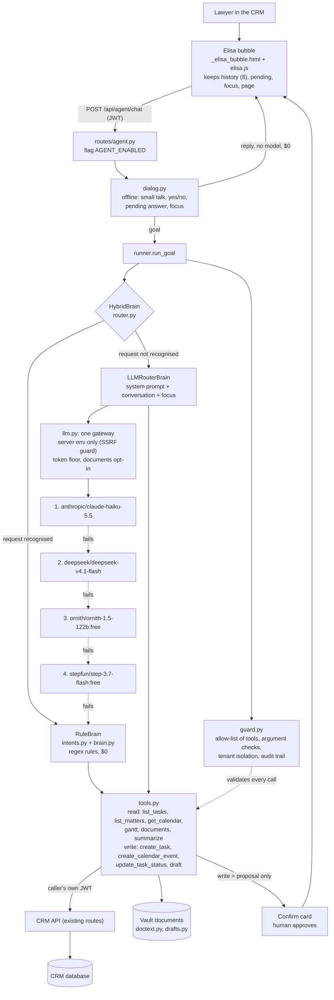

# Elisa CRM: status and architecture (2026-10-29)

*Elisa CRM is the in-app agent for the LexFlow CRM. It is separate from the website bot and from future agents such as Elisa Contract Drafter and Elisa Sales Funnel. Builder ID: `elisa-crm`. Clients see only "Elisa".*

## Status

| Item | State |
|---|---|
| Conversation memory (last 8 turns, long drafts kept up to 2,500 chars) | done |
| Pending question ("For which matter?" then "Rasing separazione") | done |
| Focus matter (follow-ups stay on the same matter) | done |
| Offline small talk, yes/no, "are you thinking?" (no model, $0) | done |
| Rules first, model only for requests the rules do not know | done |
| Model chain with fallbacks, from server environment variables | done and tested live |
| Blocked tasks, open tasks (soonest first), readable matter list instead of raw JSON | done |
| Delete/remove requests refused (no delete tool exists) | done |
| Hearing title fixed ("Hearing", not "hearing for") | done |
| Chips built from real matter names | done |
| Tests | 53 pass, 17 of them new |
| Code | local branch `lexflow_hermes_v1`, latest commit `8ec7c53`, **not pushed**; the public site keeps the feature flag `AGENT_ENABLED` off |
| Open | matter context from the page URL; model path takes 6 to 10 s; more dialogues; cross-test by another agent then Admy gate before any push |

## Architecture

## How a message flows

1. The bubble sends the text with the last 8 turns, any pending question, the focus matter and the page path.
2. `dialog.py` answers trivial messages itself: "hello", "yes please", "no", and a matter name given after Elisa asked for one. It also adds the focus matter when the user forgot to name it. Zero tokens.
3. Everything else becomes a goal. If the rules recognise it, `RuleBrain` handles it for free.
4. If not, the model reads the conversation, including her previous draft, and either calls a tool or answers. If every model fails, she falls back to the rules and never breaks.
5. Every tool call passes `guard.py` first. Tools use the caller's own JWT, so she can never see more than the user can.
6. A write does not happen directly. The user gets a confirm card and approves it.

## Cost and model quality

- Messages the rules handle cost $0. A model message costs about $0.0003 to $0.001 on Haiku.
- An assumed 20 lawyers sending 30 messages a day, with a quarter needing the model, comes to about $3 a month. This is an assumption, not a measurement.
- Test of 10 free-text prompts in English and Italian, including one injection attempt, live through Nous:

| Model | Right choice | Speed |
|---|---|---|
| claude-haiku-5.5 | 10/10 | 2.6 s |
| deepseek-v4.1-flash | 10/10 | 2.6 s |
| ornith-1.5-122b:free | 9/10 | 6.1 s |
| step-3.7-flash:free | 8/10 | 10.8 s |
| laguna-s-2.1:free | 6/10 (rate-limited) | 3.0 s |
| solar-mini4:free | 5/10 | 2.6 s |
| beam-1.0:free | 2/10 (empty replies) | 3.4 s |

## Safety rules built in

- The feature is off by default (404).
- The model address comes only from server settings, never from the client.
- Writes are proposals that need human approval.
- There is no delete tool.
- Text from documents is treated as data and is never followed as instructions.
- Documents are sent to a model only with an explicit opt-in setting.

## Family naming

`elisa-crm` (this one), `elisa-contracts`, `elisa-sales`, `elisa-web`. Clients see one "Elisa" with a small subtitle, and one entry point hands the work to the right agent. Trademark check in the EU register is still to do before investing in branding.

## Links
- Parent: [[Obsidian-INDEX]]
- Related: [[Elisa-Improvement-Plan-2026-10-27]], [[LexFlow-Platform-Plan-2026-10-24]]
