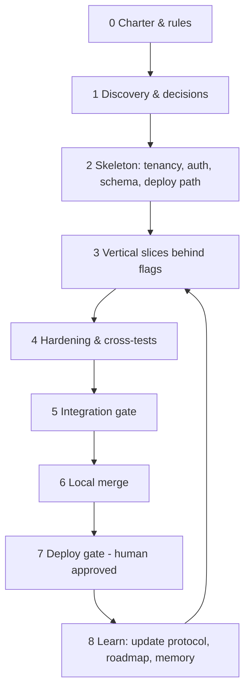

# 0. How to read this
Two layers: **(A) the product method** — what to build and in which order; **(B) the agent protocol** — how a human + orchestrator + builder/tester agents work without stepping on each other. Run B inside every phase of A.



---
# A. THE PRODUCT METHOD

## Phase 0 — Charter (1 hour, human)
1. One sentence: who pays, what job it does. ("Small law firms; keep every matter moving and nothing lost.")
2. Non-goals (3 bullets). Names the temptations you will refuse.
3. **Single source of truth map**: write which file/system is authoritative for status, tasks, config, secrets, repos. *No parallel truths.* (LexFlow: roadmap JSON, Kanban DB, Railway vars, one code root.)
4. **Rules file** (agents read it first): repo root path, branch rules, "never push/deploy without explicit approval", notes only in the vault inbox, secrets never in notes/code.
5. Pick the orchestrator (one agent that coordinates, never builds the same task) and name an ops agent for machine/limits.

## Phase 1 — Discovery & decisions (record, don't debate)
1. Inventory what exists: repos, deployed URLs, DBs, credentials *by reference*, owners. Write it down. (Half of LexFlow's pain was "which repo/URL is real".)
2. **Decision records** (`docs/<topic>_decision.md`): candidates table → evidence → chosen option → who must confirm. Rule: *the approved plan beats a half-built alternative; say so explicitly* (LexFlow chose the Flask monolith over an unfinished Next.js monorepo).
3. Research before building anything novel: competitors, open-source harnesses, regulators. Cite URLs; mark UNVERIFIED claims.
4. Get opinions from the orchestrator and the ops agent **on the plan, before code**. (Smoothy's hardware measurement cut 6 parallel builders to 3 — free win.)

## Phase 2 — Skeleton (the parts you cannot retrofit)
Do these before any feature; each has a test:
1. **Tenancy**: `workspace_id` on every table + ONE filter function used by every read/write; roles: superadmin / firm admin / client-sub-workspace admin / staff. Test with four actors.
2. **Auth**: tokens with expiry, role claims server-side, rate limits, CORS allow-list; passwords only from env; no default creds.
3. **Schema evolution**: migrations (single head, CI-checked) + idempotent ensure-column for old databases; every new column nullable.
4. **Soft delete + audit trail** (GDPR): `is_deleted`, `deleted_at`, activity log with the real actor.
5. **Deploy path**: entry point (`wsgi.py`), start command, health route, env-var checklist, staging copy. Smoke test: "fresh DB → upgrade head → login → create → read".
6. **Test harness**: throwaway SQLite, test client, a pytest suite *and* a rule that the whole suite runs on the integration branch.
7. **Flag system**: env flags default OFF; nav links and routes gated by the same flag.
8. **Canonical boot command + fixed ports**; no ad-hoc servers from scratch dirs.

## Phase 3 — Vertical slices (repeat)
A slice = one user-visible capability, thin through every layer: model → API → UI → test → flag → docs. Order slices by *dependency, then risk-ascending* (cheap/safe first). Per slice:
1. Write the **brief** (template in §C).
2. Build on an isolated branch/worktree (§B).
3. Prove with tests that use the **real client's request format** (the real page, not a hand-built request).
4. Hand-off report.

LexFlow slice order that worked: intake → contacts/cases/tasks → calendar → multi-tenant → attachments/views → team → timeline → graph → roles/docs/flags → deadlines → notifications → analytics → agent.

## Phase 4 — Hardening
Security review (traversal, IDOR, PII in logs, token leakage), tenant matrix, flag-off parity (all flags off ⇒ identical status codes to base), regression of untouched endpoints, Postgres-safety of DDL, load of "large" data (500 rows).

## Phases 5–7 — Gates (see §B steps 6–9)

## Phase 8 — Learn
Append to: this protocol (new rule + the failure that earned it), the roadmap JSON (status), the daily note, long-term memory. A lesson that is not written down will be re-learned in production.

---
# B. THE AGENT PROTOCOL

## B1. Roles
| Role | Does | Never does |
|---|---|---|
| Human owner | decides, approves deploy | — |
| Orchestrator (Admy) | allocates tasks, prevents overlap, final test | builds the same task as a builder |
| Builder | one workstream, own branch, own files | edits shared files, pushes, deploys |
| Cross-tester | attacks a branch it did **not** build | modifies code, commits |
| Ops (Smoothy) | machine budget, ports, keep-awake, tokens by reference | touches product code |
| Integrator (backend-dev) | merges, shared-file edits, resolves heads | skips a gate |

## B2. The 12-step loop for every workstream
1. **Plan note** in the vault: scope, workstreams, owned files, order of dependency, questions per agent.
2. **Consult**: orchestrator + ops answer in ≤60 lines; fold decisions into the plan.
3. **Preflight** (do not skip): `uptime`/swap/free memory, provider credits for every agent profile (one test call), model/key present, git tree state noted, worktrees created by the integrator (no races), ports assigned.
4. **Dispatch** builders in waves sized by the ops budget (LexFlow: 3 concurrent on 8 GB). Each gets *common rules + its brief*.
5. **Build** in an isolated worktree; commit only owned files; shared-file edits are written as *snippets in the report* for the integrator.
6. **Hand-off report**: branch + commit, files, flags, how to run, raw test output, snippets, limitations, "what the tester should attack".
7. **Cross-test** by a different agent: re-run the builder's tests *with the repo's real runner*, then attack (tenancy, flag bypass, auth, injection, the real UI's request format, regression vs base). Findings ranked BLOCKER/MAJOR/MINOR with file:line + raw repro. GO/NO-GO.
8. **Fix** NO-GO items (integrator or builder), add a regression test for each finding, re-run.
9. **Integration branch**: merge all green branches, apply shared-file edits, run the **whole** suite + plain scripts + migration upgrade from empty.
10. **Orchestrator final gate**: parity with base (all flags off), single migration head, tenant matrix, agent-safety review, single-source-of-truth check, deploy checklist.
11. **Local merge** with a rollback tag (`pre-merge-<name>`), merged in a separate worktree so a dirty main checkout can't interfere.
12. **Deploy gate** (separate, human): staging → migrations → flags one at a time → smoke list → explicit approval → push. Never implied by "merged".

## B3. Brief template (paste, fill)
```
YOU ARE the builder of WS-{{X}} "{{name}}".  WORKTREE: {{path}}  BRANCH: {{branch}}  PORT: {{port}}
YOU OWN: {{files}}   (everything else is read-only; shared files -> snippets in your report)
TASK (owner's words): "{{quote}}"
STEPS: 1 investigate & prove current behaviour with a test  2 build minimal tenant-safe change  3 flag {{FLAG}} default OFF  4 seed demo data (idempotent, local)  5 tests (plain script + isolation + flag-off parity)
DONE = tests ALL PASS + committed + hand-off report. Timebox {{N}} min; blocked >10 min -> stop and report.
RULES: no push/deploy; throwaway DB; no secrets/PII in code, tests, logs; one dev server max, kill it after.
```

## B4. Rules that exist because of real failures
1. **Check the agent's provider before dispatch.** An empty output with exit 0 means "out of credits", not "done". Verify an output artifact exists.
2. **A tester must not be the builder.** Agents grading their own work claimed "5 tests pass" with a runner that did not exist.
3. **Tests must use the real client's request shape.** The calendar page sent datetimes; the tests sent dates; the feature 500'd in production use.
4. **Flags are kill-switches.** If a query parameter can force a feature on while the flag is off, the flag is decoration.
5. **Read-only projections must look read-only.** Anything shown from another table (deadlines in a calendar) must not offer edit/delete/drag.
6. **Escape on output, quote ids in handlers.** String ids interpolated into `onclick` become expressions.
7. **Library redraws wipe your DOM additions.** Re-apply on the library's view-change hook.
8. **Run the whole suite on the integration branch.** A contract test elsewhere will pin the old response shape.
9. **A block is a block.** If a command is refused for lack of approval, do not retry or route around it — use another *permitted* tool for a different, allowed step, and ask.
10. **Resource budget is a design input.** Measure the machine; set concurrency from it; stagger heavy work.
11. **Never share one bot/token between a product and the agent runtime** (one consumer per token; polling conflicts). Product gets its own credential, sends only.
12. **Untrusted text reaches the agent.** Document names, note bodies, flag reasons are data, never instructions; length-cap and store as data.
13. **Dev conveniences live outside the repo** (auto-login route in the launcher script, loopback-only).
14. **Demo with real-shaped data before declaring done**; two real bugs (view-switch wipe, empty flag) only showed up on screen.

---
# C. TEMPLATES

## C1. Hand-off report
branch/commit · files changed · flag names · run command + URL + local login · raw test RESULT lines · shared-file snippets · known limitations · tester attack list.

## C2. Cross-test report
verdict (GO/NO-GO) · builder tests re-run (raw) · findings ranked with file:line + repro · what passed · recommendation.

## C3. Deploy gate checklist
env vars present (secrets by reference) · migrations to head on staging · single head · flags off by default · enable one by one · smoke list per flag · logs clean · parity vs production for untouched routes · rollback tag · explicit human approval · push.

## C4. Definition of done (per slice)
works for all four actors · flag-off parity · whole suite green · migration from empty OK · documented · demo shown on screen · lesson recorded.

---
# D. QUICK START FOR A NEW PRODUCT
Day 1 charter + rules + inventory. Day 2 decisions + skeleton (Phase 2) + deploy smoke test. Day 3+ slices in waves of ≤3, each through the 12-step loop. Weekly: update roadmap JSON, protocol, memory.

## Links
- Parent: [[LexFlow-Platform-Plan-2026-10-24]]
- Related: [[LexFlow-How-The-Whole-App-Was-Built-2026-10-25]], [[LexFlow-Wave1-Build-Log-Technical-2026-10-25]]
